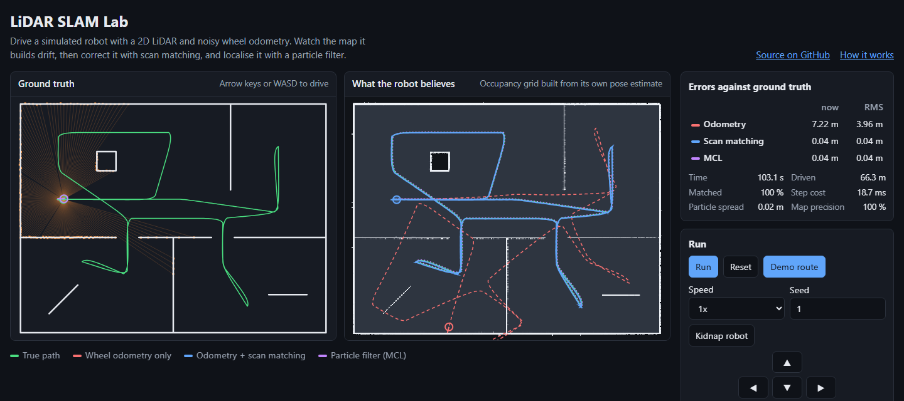
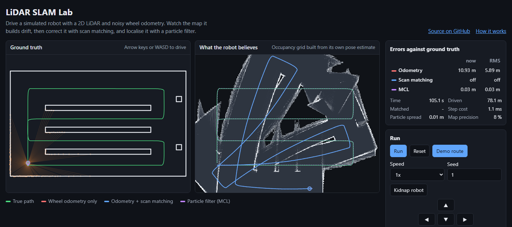

# LiDAR SLAM Lab

[](https://github.com/projectbin07-stack/lidar-slam-lab/actions/workflows/ci.yml)
[](LICENSE)

A browser sandbox for 2D robot mapping and localisation: drive a simulated
robot with a LiDAR and noisy wheel odometry, watch the map it builds smear as
the odometry drifts, then turn on scan matching and a particle filter and see
how much of the error they remove.

**Live demo: https://projectbin07-stack.github.io/lidar-slam-lab/**



## Why

SLAM is easiest to understand by watching it fail. Textbook figures show the
end result; here you can change the odometry error, the LiDAR noise or the
floor plan and see immediately what happens to the trajectory and the map,
with the ground truth next to it and the error in metres. Everything runs
client-side with no dependencies, and the same code runs headless from a CLI
to produce reproducible numbers.

## Features

- **Floor plans**: three built-in maps (office, warehouse aisles, corridor
  loop), an empty room, drawing and erasing walls with the mouse or a finger,
  and loading/saving maps as JSON.
- **Robot**: unicycle model with collision checks, keyboard (arrows/WASD) or
  touch driving, or an autopilot that follows each map's demo route.
- **Simulated 2D LiDAR**: ray casting against the walls, Gaussian range noise,
  random dropouts, configurable beam count and range.
- **Wheel odometry errors**: the rot1-trans-rot2 odometry error model plus a
  systematic heading bias, so dead reckoning drifts like a real robot's.
- **Occupancy grid mapping**: log-odds grid with the inverse sensor model,
  built from the robot's own pose estimate.
- **Scan matching**: correlative search on a likelihood field (exact
  Euclidean distance transform) corrects each odometry step against the map
  built so far.
- **Monte Carlo localisation**: particle filter on the known floor plan with
  low-variance resampling and augmented-MCL recovery, for pose tracking or
  global localisation from an unknown start. A "kidnap" button moves the
  robot without telling the estimators.
- **Live comparison**: current and RMS position error of dead reckoning, scan
  matching and MCL, map precision, match acceptance rate and step cost.
- **Exports**: the built map as a ROS `map_server` PGM, trajectories as CSV.
- **Headless CLI** for scripted runs and the benchmark below.
- Seeded random numbers: the same seed and settings give the same run in the
  browser and the CLI.

How each part works, with the parameters and references, is in
[docs/algorithms.md](docs/algorithms.md).

## Quick start

In the browser: open the [live demo](https://projectbin07-stack.github.io/lidar-slam-lab/)
and press **Demo route**, or drive with the arrow keys. Untick "Scan matching
corrects odometry" and press **Reset** to see the map that odometry alone
produces.

URL parameters make a view reproducible, for example
[`?map=warehouse&run=1051&scanmatch=0&paused=1`](https://projectbin07-stack.github.io/lidar-slam-lab/?map=warehouse&run=1051&scanmatch=0&paused=1)
drives the whole warehouse route with dead reckoning only:



Supported parameters: `map` (office, warehouse, loop, empty), `seed`,
`run` (steps to drive on the demo route before the first frame, up to 5000),
`paused=1`, `scanmatch=0`, `particles` (0, 300, 1000, 3000), `global=1`.

Locally (Node 22 or newer):

```bash
git clone https://github.com/projectbin07-stack/lidar-slam-lab.git
cd lidar-slam-lab
npm ci                 # dev tools only
npm run serve          # then open http://127.0.0.1:8000/
```

Any static file server works; the page cannot be opened from `file://`
because browsers do not load ES modules from there.

### CLI

```
$ node bin/lidar-slam-lab.js run --map warehouse --global --particles 2000 --seed 2
map              Warehouse aisles (seed 2)
route            finished after 105.1 s, 78.1 m
                 final error   RMS error
dead reckoning     10.650 m     5.906 m
scan matching       0.637 m     0.667 m
MCL (global)        0.033 m     1.870 m
scan matches     100.0 % accepted
map precision    76.2 % of 5010 occupied cells within 0.1 m of a true wall
collisions       0
```

The global MCL run starts with the particles spread over the whole warehouse,
so its RMS includes the time before it converged; it ends 3 cm from the truth.

`--out results` additionally writes `map.pgm` + `map.yaml` (loadable by ROS
`map_server`) and `trajectory.csv` with the true, odometry, scan-matched and
MCL poses at every step. Full usage:

```
$ node bin/lidar-slam-lab.js --help
lidar-slam-lab 0.2.1: 2D LiDAR SLAM and localisation simulator

Usage:
  lidar-slam-lab maps
  lidar-slam-lab export-map <map-id>
  lidar-slam-lab run [options]
  lidar-slam-lab localize <scans.jsonl> [options]
  lidar-slam-lab benchmark [--maps office,warehouse,loop] [--seeds 5] [--steps N]
  lidar-slam-lab --help | --version

run drives the map's demo route with the autopilot and prints the errors of
dead reckoning, scan matching and MCL against the ground truth.

Options for run:
  --map <id|file.json>    built-in map id or a map JSON file (default: office)
  --seed <n>              random seed (default: 1)
  --steps <n>             stop after n steps of 0.1 s even if the route
                          is not finished (default: 3000, max 10000)
  --no-scan-matching      dead reckoning only for the mapping estimate
  --particles <n>         MCL particle count, 0 disables (default: 300)
  --global                start MCL with no idea where the robot is
  --odom-noise <k>        scale every odometry error term by k (default: 1)
  --range-noise <m>       LiDAR range noise std in metres (default: 0.02)
  --dropout <p>           probability a beam returns nothing (default: 0.03)
  --beams <n>             beams per scan (default: 180)
  --out <dir>             write map.pgm, map.yaml and trajectory.csv there
  --scan-log <file>       also write every scan with the odometry and true
                          pose as a scan log (the input format of localize)
  --json                  print the summary as JSON

localize runs the same estimators on recorded scans: a JSON Lines file with
one sensor_msgs/LaserScan-like object per line plus the odometry pose at that
scan (format in docs/algorithms.md). Without --map it builds a map with
odometry + scan matching; with --map it also runs MCL on that floor plan.

Options for localize:
  --mount <x,y,yaw>       LiDAR pose in the robot frame (m, m, rad; default 0,0,0)
  --start <x,y,theta>     robot pose at the first scan in the map frame
                          (default: the map's start with --map, else the first
                          odometry pose)
  --map <id|file.json>    known floor plan for MCL
  --particles <n>         MCL particle count, 0 disables (default: 300)
  --global                start MCL with no idea where the robot is
  --motion <model>        MCL motion model: odometry (rot1-trans-rot2) or omni
                          (forward, sideways, turn; for mecanum bases)
  --no-scan-matching      dead reckoning only for the mapping estimate
  --seed <n>              MCL random seed (default: 1)
  --out <dir>             write map.pgm, map.yaml and trajectory.csv there
  --json                  print the summary as JSON
```

### Recorded scans

`localize` runs the estimators on a scan log instead of the simulator, for
example one written by `run --scan-log`, or converted from a ROS 2 bag's
`/scan` and `/odom` (rosbag-inspect `export --arrays` keeps the ranges):

```
$ node bin/lidar-slam-lab.js run --map office --scan-log office.jsonl
...
wrote 1032 scans to office.jsonl
$ node bin/lidar-slam-lab.js localize office.jsonl --map office
scans            1032 over 103.1 s, 66.2 m by odometry
scan matches     100.0 % accepted
final pose       x, y, theta
  odometry       4.949, 0.303, -1.826
  scan matching  2.209, 6.979, 3.136
  MCL            2.276, 7.024, 3.139
RMS error against the log's truth poses: odometry 3.962 m, scan matching 0.038 m, MCL 0.037 m
```

The numbers agree with the `run` above (dead reckoning 3.964 m, scan
matching 0.038 m, MCL 0.036 m RMS) to within a few millimetres: the log
rounds ranges to 0.1 mm. The format is in
[docs/algorithms.md](docs/algorithms.md#recorded-scans-scanlogjs-lidar-slam-lab-localize).

### Library

Since 0.2.0 `package.json` has an `exports` map naming the public modules
(`lidar-slam-lab/lidar`, `/motion`, `/grid`, `/distance`, `/scanmatch`,
`/mcl`, `/scanlog`, `/sim`, ...); all of them are DOM-free ES modules. New in
0.2.0: a LiDAR mount pose (`simulateScan(..., mount)`, `scan.origin`, used by
the grid, scan matching and MCL), `minRange` and `angleMin` in the LiDAR
settings, MCL's `motionModel: "omni"` for holonomic bases, and the scan log
reader. With the default settings every result is the same as in 0.1.0 (the
benchmark below is unchanged).

## Benchmark

`npm run benchmark` drives each map's demo route with seeds 1 to 5 and
default settings, and reports the RMS position error over the route. Output
from one run on the development machine (these are simulation results with
made-up noise parameters, not measurements of any real robot):

```
RMS position error over the demo route, metres (lower is better)

map         seed  distance  dead-reckoning  scan-matching  MCL-tracking
office         1     66.3 m           3.964          0.038         0.036
office         2     66.3 m           3.908          0.038         0.036
office         3     66.3 m           3.628          0.038         0.037
office         4     66.3 m           3.997          0.096         0.037
office         5     66.3 m           4.770          0.059         0.036
office      mean                      4.053          0.054         0.036
warehouse      1     78.1 m           5.891          0.499         0.029
warehouse      2     78.1 m           5.906          0.667         0.028
warehouse      3     78.1 m           5.763          1.080         0.030
warehouse      4     78.1 m           5.857          0.499         0.029
warehouse      5     78.1 m           6.431          0.811         0.027
warehouse   mean                      5.970          0.711         0.028
loop           1     54.1 m           3.649          0.039         0.033
loop           2     54.1 m           4.030          0.072         0.033
loop           3     54.1 m           3.687          0.056         0.034
loop           4     54.1 m           4.033          0.056         0.035
loop           5     54.1 m           4.120          0.039         0.034
loop        mean                      3.904          0.052         0.034
```

What it shows: scan matching cuts the error by about two orders of magnitude
in the office and the loop. In the warehouse it does much worse (0.5 to 1.1 m)
because the long, identical shelf rows give the matcher nothing to pin the
position along an aisle, so errors slip into the map and stay there; there is
no loop closure to fix them. MCL does well everywhere in this table because it
is given the true floor plan and starts at the true pose; that is a much
easier problem than building the map.

The numbers are deterministic for a given seed, so a change to an algorithm
can be compared before and after.

## Architecture

```
index.html, styles.css      the page; loads src/app.js as an ES module
src/
  app.js        DOM, drawing, input (the only browser-specific module)
  sim.js        one simulation step: robot, odometry, LiDAR, estimators
  geometry.js   ray casting, segment tests, angles
  motion.js     unicycle model, odometry error model
  lidar.js      simulated scans
  grid.js       log-odds occupancy grid, Bresenham ray tracing
  distance.js   Euclidean distance transform, likelihood field
  scanmatch.js  correlative scan-to-map matching
  mcl.js        particle filter (rot1-trans-rot2 or omnidirectional motion model)
  scanlog.js    recorded scans (JSON Lines) through the same estimators
  autopilot.js  waypoint follower
  world.js      map format, validation, collisions
  maps.js       built-in floor plans
  metrics.js    error measures
  export.js     PGM/YAML and CSV writers
  view.js       world <-> canvas transform
  rng.js        seeded random numbers
  cli.js        headless CLI (Node only, not shipped to the site)
bin/lidar-slam-lab.js   CLI entry point
scripts/serve.js        static server for local development
```

There is no bundler or build step. GitHub Pages serves `index.html`,
`styles.css` and `src/` as they are. All modules except `app.js` and `cli.js`
are plain computation with no DOM or Node APIs, so the tests and the CLI run
exactly the code the browser runs. Types are JSDoc annotations checked by
`tsc --checkJs --strict`.

## Testing

```bash
npm ci
npm run check     # Prettier, TypeScript (JSDoc) type check, tests with coverage thresholds
```

The tests use `node:test` and check results against values that can be
worked out by hand: ray hits in a known room, the arc of a quarter turn,
Bresenham cells, log-odds updates, the distance transform against a
brute-force reference, systematic resampling on hand-worked weights, the
statistics of the noise models, and end-to-end properties such as "with zero
noise the estimate equals the truth" and "with the same noise, scan matching
reduces the RMS error at least threefold". Coverage of the simulation modules
is above 99 % of lines (thresholds are enforced in CI).

CI runs on Ubuntu and Windows with Node 22 and 24, smoke-tests the CLI, and
loads the page in headless Chrome to check that the modules load and the
simulation runs.

## Known limitations

- **Simulation only.** Nothing here has been run on a real robot or a real
  LiDAR. The noise parameters are plausible but invented.
- **No loop closure.** The scan matcher only matches against the map built so
  far; there is no pose graph. Errors it lets through stay in the map, as the
  warehouse result shows.
- The matcher's search window is +/-0.2 m and +/-0.1 rad per step. Much
  larger odometry errors per step (high "Odometry error" settings, or a
  kidnapped robot) break it.
- MCL uses the true floor plan, not the map being built. Global localisation
  can settle on the mirror-image pose in the nearly symmetric corridor loop.
- The LiDAR model has no beam width, reflectivity or motion distortion.
  Walls are infinitely thin line segments.
- Recorded scans (`localize`) have only been tested with logs written by the
  simulator; no real LiDAR recording has been run through it yet.
- The autopilot steers with the true pose, so that runs with different
  estimators drive the same path.
- Step cost is about 15 ms on the development machine with scan matching and
  300 particles; at 4x speed slow devices drop simulated time rather than
  stutter.

## Roadmap

- Pose-graph optimisation with loop closure, to fix the warehouse case.
- ICP (point-to-line) as a second scan matcher to compare against.
- Scan-to-scan matching for odometry when no map exists yet.
- A mode where MCL localises in the map the robot built itself.
- Run a real recorded 2D dataset through `localize` and report the result.

## License

MIT, see [LICENSE](LICENSE).
